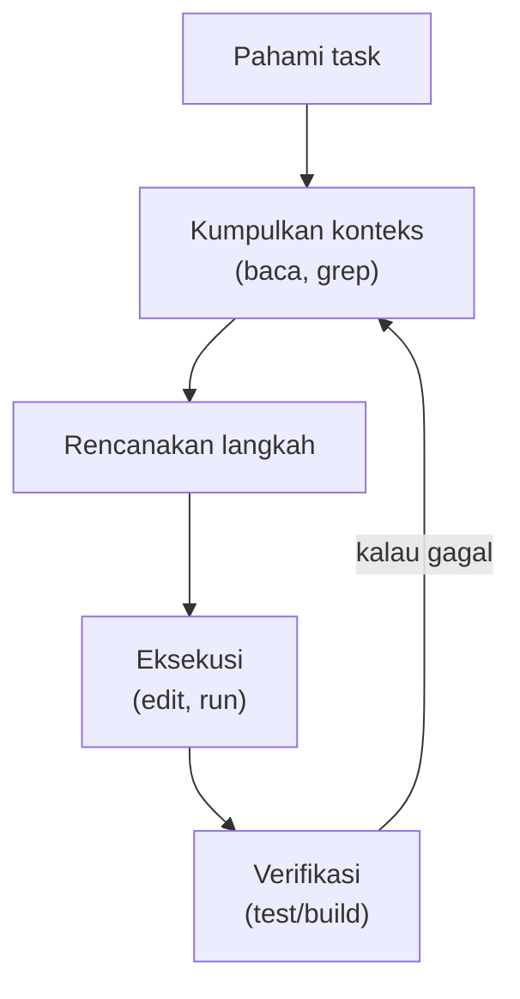

## 1. Pengenalan Claude Code & Cara Install

### Apa itu Claude Code

Claude Code adalah **agentic coding tool** dari Anthropic. Bedanya dengan chat AI biasa atau autocomplete:

| Aspek | Chat AI biasa | Autocomplete IDE | Claude Code |
|---|---|---|---|
| Akses ke codebase | Copy-paste manual | File yang sedang dibuka | Seluruh repo (bisa search & baca sendiri) |
| Menjalankan command | Tidak | Tidak | Ya (test, build, git, dll.) |
| Mengedit file | Kita yang apply | Per baris/blok | Langsung, multi-file |
| Verifikasi hasil | Kita sendiri | Kita sendiri | Bisa jalankan test dan memperbaiki sendiri |

Anggap Claude Code sebagai *pair programmer* yang bisa diberi tugas, bukan sekadar mesin penjawab pertanyaan.

---

### Agent loop



Claude **tidak** otomatis tahu isi seluruh repo. Ia mencari dan membaca file yang relevan sesuai kebutuhan, seperti developer baru yang sedang eksplorasi.

---

### Persyaratan

- OS: macOS 13+, Windows 10 (1809+), Ubuntu 20.04+, Debian 10+, atau Alpine 3.19+
- RAM 4 GB+, koneksi internet
- Akun **Pro / Max / Team / Enterprise**, atau akun **Console** (API). Plan gratis claude.ai tidak termasuk akses Claude Code. Bisa juga lewat provider pihak ketiga (Amazon Bedrock, Google Cloud, Microsoft Foundry).

---

### Instalasi

**macOS / Linux / WSL (native install, direkomendasikan):**

```bash
curl -fsSL https://claude.ai/install.sh | bash
```

**Windows PowerShell:**

```powershell
irm https://claude.ai/install.ps1 | iex
```

**Alternatif:**

```bash
brew install --cask claude-code        # Homebrew
winget install Anthropic.ClaudeCode    # WinGet
npm install -g @anthropic-ai/claude-code   # npm (butuh Node.js 22+)
```

| Metode | Auto-update |
|---|---|
| Native installer | Ya, di background |
| Homebrew / WinGet / npm | Tidak, update manual (`brew upgrade claude-code`, dst.) |

Cek instalasi dan kesehatan konfigurasi:

```bash
claude --version
claude doctor      # diagnosa instalasi & settings
claude update      # update manual
```

> Kalau `claude` tidak ditemukan setelah install, buka terminal baru. Jika masih gagal, biasanya direktori install belum masuk `PATH`.

---

### Login & first run

```bash
cd project-saya
claude
```

Saat pertama kali jalan, ikuti prompt login di browser. Lalu coba prompt pertama:

```
Jelaskan struktur project ini dan teknologi yang dipakai.
```

Jalankan `/init` untuk men-generate `CLAUDE.md` (semacam "README untuk Claude") yang otomatis dibaca di setiap sesi.

---

## 2. Cara Pakai: Terminal, IDE, Claude Desktop

Semuanya memakai engine yang sama dan membaca file settings yang sama (`~/.claude/settings.json`, dst.), jadi konfigurasi di satu tempat berlaku di semuanya.

| Surface | Cocok untuk | Catatan |
|---|---|---|
| **Terminal (CLI)** | Fitur paling lengkap, scripting, CI | Semua command, flag, dan `-p` (headless) tersedia |
| **IDE** (VS Code, Cursor, JetBrains) | Melihat diff langsung di editor, kirim selection/file aktif sebagai konteks | Install extension (VS Code/Cursor) atau plugin (JetBrains) |
| **Claude Desktop** (tab *Code*) | Yang lebih nyaman dengan GUI, tanpa terminal | Pilih folder project, mode dipilih lewat selector di bawah prompt |

### Terminal

```bash
claude                      # sesi interaktif
claude "jelaskan repo ini"  # sesi interaktif dengan prompt awal
claude -c                   # lanjutkan sesi terakhir
claude -r                   # pilih sesi lama untuk di-resume
```

Shortcut penting:

| Shortcut / perintah | Fungsi |
|---|---|
| `@nama-file` | Mereferensikan file tertentu ke dalam prompt |
| `!perintah` | Menjalankan shell command langsung dari prompt |
| `Esc` | Menghentikan Claude di tengah jalan |
| `Esc` `Esc` | Kembali ke titik sebelumnya (rewind) |
| `Shift+Tab` | Ganti permission mode |
| `/clear` | Mulai konteks bersih (saat ganti task) |
| `/compact` | Ringkas percakapan agar hemat context |
| `/help` | Daftar perintah |

### IDE

- **VS Code / Cursor:** install extension *Claude Code* dari marketplace, buka panel Claude, dan Claude melihat file/selection yang sedang aktif. Perubahan tampil sebagai diff di editor.
- **JetBrains:** install plugin Claude Code dari marketplace IDE.
- Sudah menjalankan `claude` di terminal bawaan IDE? Pakai `/ide` untuk menyambungkannya ke IDE.

### Claude Desktop

Buka aplikasi Claude, pindah ke tab **Code**, pilih folder project, lalu mulai prompt. Cocok untuk demo atau tim yang kurang familiar dengan terminal.

> Ada juga versi web di claude.ai/code yang berjalan di cloud (bukan di mesin kita), jadi hanya sebagian settings lokal yang terbaca di sana.

---

## 3. Mengamankan Workspace: `settings.json` & `/sandbox`

Claude Code bisa membaca file, menjalankan command, dan mengakses jaringan. Karena itu workspace perlu dipagari. Ada dua lapisan yang saling melengkapi:

| Lapisan | Mengatur | Cara kerja |
|---|---|---|
| **Permission rules** (`settings.json`) | Tool apa yang boleh/tidak boleh dipakai Claude | Aturan `allow` / `ask` / `deny` per tool |
| **Sandbox** (`/sandbox`) | Apa yang bisa disentuh *shell command* di level OS | Isolasi filesystem & network oleh sistem operasi |

### Lokasi `settings.json`

| Scope | File | Berlaku untuk |
|---|---|---|
| User | `~/.claude/settings.json` | Kita, di semua project |
| Shared project | `.claude/settings.json` | Seluruh tim (di-commit ke git) |
| Project local | `.claude/settings.local.json` | Kita saja, di project ini (jangan di-commit) |
| Managed | `managed-settings.json` / MDM / console | Seluruh organisasi, tidak bisa di-override |

Di tabel, `~/.claude` adalah folder `.claude` di home directory, dan `.claude` tanpa `~` adalah folder `.claude` di dalam project.

**Di Windows**, `~/.claude` berarti `%USERPROFILE%\.claude`, misalnya `C:\Users\<nama>\.claude\settings.json`. Di PowerShell, `~\.claude\settings.json` juga bisa dipakai. Lokasi folder ini bisa dipindah dengan environment variable `CLAUDE_CONFIG_DIR`. Scope project (`.claude\settings.json` dan `.claude\settings.local.json`) tetap berada di root repo.

File `managed-settings.json` disimpan di folder sistem, dan path-nya berbeda per OS:

| OS | Path |
|---|---|
| macOS | `/Library/Application Support/ClaudeCode/managed-settings.json` |
| Linux dan WSL | `/etc/claude-code/managed-settings.json` |
| Windows | `C:\Program Files\ClaudeCode\managed-settings.json` |

Urutan prioritas (tertinggi dulu): **Managed → command line (`--settings`) → project local → shared project → user**. List seperti `permissions.allow` digabung antar file, bukan saling menimpa.

Perubahan di file ini otomatis di-reload tanpa restart. Cek file mana yang aktif dengan `/status`.

### Permission rules

Contoh `.claude/settings.json` yang aman untuk project umum:

```json
{
  "$schema": "https://json.schemastore.org/claude-code-settings.json",
  "permissions": {
    "allow": [
      "Bash(npm run lint)",
      "Bash(npm run test *)",
      "Bash(git diff *)"
    ],
    "ask": [
      "Bash(git push *)"
    ],
    "deny": [
      "Read(./.env)",
      "Read(./.env.*)",
      "Read(./secrets/**)",
      "Bash(rm -rf *)",
      "Bash(grep:*.env*)",
      "Bash(cat:*.env*)"
    ]
  }
}
```

- **`allow`**: jalan tanpa bertanya
- **`ask`**: selalu tanya
- **`deny`**: diblokir total. `deny` mengalahkan `allow`.
- Format rule: `NamaTool(pola)`, misalnya `Bash(npm run test *)` atau `Read(./.env)`.

Tips:

- **Blokir pembacaan file rahasia** (`.env`, kunci, kredensial) lewat `deny`. Ini cara termudah mencegah secret ikut terkirim ke model.
- Pilihan "Yes, and don't ask again" di prompt permission otomatis menyimpan rule `allow` ke `.claude/settings.local.json`.
- File JSON harus **strict**: komentar `//` atau trailing comma membuat file dianggap rusak. Cek dengan `claude doctor`.
- Rule `allow` di `.claude/settings.json` baru berlaku setelah tiap anggota tim memercayai (*trust*) folder tersebut. Rule `deny` dan `ask` langsung berlaku.

### `/sandbox`: isolasi di level OS

Permission rules mengatur *apakah Claude boleh menjalankan* sebuah command. Sandbox membatasi *apa yang bisa dilakukan* command itu setelah jalan, bahkan kalau command-nya berbahaya atau Claude kena prompt injection.

Aktifkan dengan:

```
/sandbox
```

Panel akan menampilkan tab **Mode**, **Overrides**, dan **Config**. Atau aktifkan permanen lewat settings:

```json
{
  "sandbox": {
    "enabled": true,
    "filesystem": {
      "allowWrite": ["~/.kube", "/tmp/build"]
    },
    "network": {
      "allowedDomains": ["github.com", "*.npmjs.org"]
    },
    "excludedCommands": ["docker compose *"]
  }
}
```

**Dua mode sandbox:**

| Mode | Perilaku |
|---|---|
| **Auto-allow** | Command yang berjalan di dalam sandbox tidak perlu persetujuan, jadi lebih sedikit prompt |
| **Regular permissions** | Semua command Bash tetap lewat alur permission normal |

**Yang dibatasi secara default:**

| Akses | Default |
|---|---|
| Tulis | Hanya working directory, folder temp, dan folder tambahan. Path sensitif seperti `.claude` dan startup shell tetap terkunci |
| Baca | Sebagian besar mesin (termasuk `~/.ssh` dan `~/.aws/credentials`), batasi dengan `denyRead` |
| Network | Lewat proxy lokal, hanya domain di `allowedDomains` (awalnya kosong) |

**Perlu diingat:**

- Sandbox **off** secara default.
- Dukungan OS: macOS (Seatbelt, bawaan), Linux & WSL2 (butuh `bubblewrap` dan `socat`). **Windows native tidak didukung**, gunakan WSL2.
- Sandbox hanya mencakup command shell (Bash/PowerShell). Tool `Read`/`Edit`/`Write`, MCP server, dan hooks **tidak** tercakup, jadi tetap dijaga oleh permission rules.
- `excludedCommands` menjalankan command di luar sandbox dengan akses penuh, buat pola sesempit mungkin.
- Kalau sandbox tidak bisa start (dependency kurang), Claude Code berjalan tanpa sandbox kecuali `sandbox.failIfUnavailable` diset `true`.

### Checklist keamanan workspace

- [ ] `deny` untuk `.env`, folder secrets, dan command destruktif
- [ ] Aktifkan `/sandbox` (auto-allow) untuk mengurangi prompt tanpa mengorbankan keamanan
- [ ] Jangan taruh API key/password di prompt atau `CLAUDE.md`
- [ ] Commit `.claude/settings.json` agar seluruh tim punya pagar yang sama
- [ ] Jangan pakai `--dangerously-skip-permissions` di mesin dengan data sensitif
- [ ] Selalu review diff sebelum commit, dan pakai git sebagai jaring pengaman

---

## 4. Mode di Claude Code

Mode menentukan seberapa banyak yang boleh dikerjakan Claude **tanpa bertanya**. Ganti saat sesi berjalan dengan `Shift+Tab`.

| Mode | Jalan tanpa bertanya | Cocok untuk |
|---|---|---|
| `manual` | Hanya membaca. Edit, command, dan network tetap tanya | Mereview setiap aksi |
| `acceptEdits` | Baca, edit file, dan command filesystem umum (`mkdir`, `mv`, `cp`, dll.) di working directory | Iterasi kode yang akan kita review |
| `plan` | Baca dan eksplorasi saja. Edit diblokir sampai rencana disetujui | Eksplorasi sebelum mengubah kode |
| `auto` | Semuanya, kecuali yang diblokir oleh model classifier | Task panjang dengan sedikit interupsi |


Cara mengganti:

```bash
# Saat sesi: tekan Shift+Tab untuk berpindah (default → acceptEdits → plan)

# Saat start
claude --permission-mode plan

# Sebagai default, di settings.json
{
  "permissions": { "defaultMode": "acceptEdits" }
}
```

Catatan:

- `auto` dan `bypassPermissions` muncul di siklus `Shift+Tab` hanya bila tersedia/diaktifkan. `dontAsk` tidak pernah muncul di siklus.
- `defaultMode` `auto` dan `bypassPermissions` **tidak berlaku** bila ditulis di settings project (shared maupun local). Set di user settings atau lewat flag.
- Path terproteksi (`.git`, `.claude`, `.bashrc`) tidak pernah di-auto-approve, kecuali di `bypassPermissions`.

### Plan mode dalam praktik

Alur yang aman untuk perubahan besar: **Explore → Plan → Code → Commit**.

1. **Explore:** "Baca modul X dan Y, jangan ubah apa-apa dulu."
2. **Plan:** pindah ke plan mode, minta rencana, lalu review dan koreksi.
3. **Code:** setujui rencana (misalnya lanjut dengan `acceptEdits`), biarkan Claude eksekusi.
4. **Commit:** review diff, lalu commit.

Kalau Claude salah arah, tekan `Esc` lebih awal. Kalau sudah terlalu melenceng, `/clear` dan mulai lagi dengan prompt yang lebih baik.

---

## 5. Command, Skills, MCP, Plugins, Subagents, Hooks, Headless

Ini adalah "kotak peralatan" untuk memperluas Claude Code. Ringkasannya:

| Fitur | Intinya | Lokasi / perintah |
|---|---|---|
| **Command** | Prompt tersimpan yang dipanggil dengan `/nama` | `.claude/commands/*.md` |
| **Skills** | Paket instruksi + script, dimuat saat relevan | `.claude/skills/<nama>/SKILL.md` |
| **MCP** | Sambungan ke tools/data eksternal | `claude mcp add`, `.mcp.json` |
| **Plugins** | Bundel command, skills, agents, hooks, MCP | `/plugin` |
| **Subagents** | Agent khusus dengan context terpisah | `.claude/agents/*.md`, `/agents` |
| **Hooks** | Shell command otomatis di event tertentu | `hooks` di `settings.json` |
| **Headless** | Claude Code non-interaktif untuk script/CI | `claude -p "..."` |

### a. Command

Selain slash command bawaan (`/help`, `/clear`, `/compact`, `/init`, `/status`, `/sandbox`, dst.), kita bisa membuat sendiri. Simpan prompt yang sering dipakai sebagai file Markdown:

`.claude/commands/review.md`

```markdown
Review perubahan di branch ini terhadap main.
Fokus pada: bug potensial, keamanan, dan konsistensi dengan konvensi di CLAUDE.md.
Berikan hasil dalam bentuk daftar temuan beserta tingkat prioritas.
```

Dipanggil dengan `/review`. Letakkan di `~/.claude/commands/` untuk dipakai di semua project.

### b. Skills

Skill adalah folder berisi `SKILL.md` (dan opsional script/referensi) yang dimuat Claude **saat relevan**, atau dipanggil manual dengan `/nama-skill`. Cocok untuk prosedur berulang: alur deploy, checklist review, cara membuat laporan, dll.

`.claude/skills/release-notes/SKILL.md`

```markdown
---
name: release-notes
description: Buat release notes dari commit sejak tag terakhir. Dipakai saat diminta membuat changelog atau release notes.
---

1. Jalankan `git log` dari tag terakhir sampai HEAD.
2. Kelompokkan commit: Fitur, Perbaikan, Lainnya.
3. Tulis dalam Bahasa Indonesia, satu baris per perubahan.
```

Perbedaan dengan command: command adalah satu prompt statis, skill bisa membawa banyak file pendukung dan dipilih otomatis oleh Claude berdasarkan `description`. Karena itu `description` harus jelas kapan skill dipakai.

### c. MCP (Model Context Protocol)

Menghubungkan Claude Code ke tools eksternal: database, Jira/Linear, Sentry, Figma, browser, dan lainnya.

```bash
# server remote (HTTP)
claude mcp add --transport http notion https://mcp.notion.com/mcp

# server lokal (stdio)
claude mcp add playwright -- npx @playwright/mcp@latest

claude mcp list          # daftar server
/mcp                     # status & autentikasi dari dalam sesi
```

Scope konfigurasi: *local* (default, pribadi per project), *project* (disimpan di `.mcp.json` dan bisa di-commit untuk tim), dan *user* (semua project).

Contoh use case: "Ambil detail tiket PROJ-123 dari Jira lalu implementasikan."

> **Keamanan:** MCP server tidak tercakup sandbox. Pasang hanya server yang dipercaya, dan batasi tool-nya lewat permission rules.

### d. Plugins

Plugin adalah **bundel** command, skills, subagents, hooks, dan MCP server dalam satu paket yang bisa di-install dan dibagikan lewat *marketplace*.

```
/plugin                 # buka manajer plugin (browse, install, enable/disable)
```

Tim bisa mendeklarasikan marketplace dan plugin wajib di `.claude/settings.json` (`extraKnownMarketplaces`, `enabledPlugins`) agar setup seragam. Sama seperti rule `allow`, ini baru berlaku setelah folder dipercaya.

### e. Subagents

Agent khusus dengan instruksi, tools, dan context window **sendiri**. Hasil kerjanya diringkas kembali ke sesi utama, jadi context utama tidak penuh. Cocok untuk:

- Code reviewer
- Test writer
- Riset/eksplorasi codebase yang membaca banyak file

`.claude/agents/code-reviewer.md`

```markdown
---
name: code-reviewer
description: Review kode setelah perubahan selesai. Gunakan secara proaktif sebelum commit.
tools: Read, Grep, Glob, Bash
---

Kamu adalah reviewer yang teliti. Periksa bug, celah keamanan, dan konsistensi
dengan konvensi project. Laporkan temuan berurutan dari yang paling serius.
Jangan mengubah file.
```

Dikelola lewat `/agents` atau langsung edit file di `.claude/agents/`. Bisa juga dipanggil eksplisit: "Pakai subagent code-reviewer untuk memeriksa perubahan ini."

### f. Hooks

Shell command yang dijalankan **otomatis** pada event tertentu, misalnya:

| Event | Contoh pemakaian |
|---|---|
| `PreToolUse` | Blokir command berbahaya sebelum dijalankan |
| `PostToolUse` | Jalankan formatter/linter setelah file diedit |
| `Stop` | Kirim notifikasi saat Claude selesai |

Hooks memberi jaminan **deterministik**: tidak bergantung pada Claude "ingat" instruksi di `CLAUDE.md`.

Contoh di `.claude/settings.json`: format otomatis setiap file yang diedit.

```json
{
  "hooks": {
    "PostToolUse": [
      {
        "matcher": "Edit|Write",
        "hooks": [
          {
            "type": "command",
            "command": "jq -r '.tool_input.file_path' | xargs npx prettier --write"
          }
        ]
      }
    ]
  }
}
```

Hook menerima detail event sebagai JSON lewat stdin. Untuk hook `PreToolUse`, keluar dengan **exit code 2** akan memblokir aksi, dan pesan di stderr dikirim balik ke Claude:

```json
{
  "hooks": {
    "PreToolUse": [
      {
        "matcher": "Bash",
        "hooks": [
          {
            "type": "command",
            "command": "jq -r '.tool_input.command' | grep -q 'rm -rf' && { echo 'rm -rf diblokir' >&2; exit 2; } || exit 0"
          }
        ]
      }
    ]
  }
}
```

Hooks berjalan dengan hak akses kita dan tidak tercakup sandbox, jadi review hook dari sumber lain sebelum dipakai.

### g. Headless

Mode non-interaktif dengan flag `-p` (print). Claude menjalankan task, mencetak hasil, lalu keluar. Cocok untuk script dan CI.

```bash
# pertanyaan sederhana
claude -p "Jelaskan fungsi main di src/index.ts"

# pipe input
git diff main | claude -p "Review perubahan ini, fokus pada bug dan keamanan"
claude -p "Analisa error log ini dan berikan ringkasan" < error.log

# output terstruktur untuk diproses script
claude -p "Daftar semua endpoint API" --output-format json

# batasi tool yang boleh dipakai (tidak ada yang bisa ditanya di mode ini)
claude -p "Perbaiki lint error" --allowedTools "Read,Edit,Bash(npm run lint)"
```

Karena tidak ada manusia yang bisa menyetujui prompt, tentukan izin secara eksplisit (`--allowedTools` atau `--permission-mode dontAsk`), dan jalankan di environment terisolasi bila memberi akses luas. Contoh pemakaian: auto-review PR, triage issue, atau ringkasan log di pipeline CI.

---

## Ringkasan

1. **Install** dengan native installer, login, lalu `claude` di root project dan `/init`.
2. **Pilih surface** yang nyaman: terminal (paling lengkap), IDE (diff di editor), atau Claude Desktop (GUI).
3. **Pagari workspace:** `deny` untuk secret di `settings.json`, aktifkan `/sandbox`.
4. **Kenali mode:** `default` untuk hati-hati, `plan` untuk eksplorasi, `acceptEdits` untuk iterasi, `auto` untuk task panjang. `bypassPermissions` hanya di VM/container.
5. **Perluas kemampuan** bertahap: command → skills → MCP → subagents → hooks → plugins → headless/CI.

---

## Referensi

- Dokumentasi resmi: https://code.claude.com/docs/en/overview
- Setup & instalasi: https://code.claude.com/docs/en/setup
- Settings: https://code.claude.com/docs/en/settings
- Permission modes: https://code.claude.com/docs/en/permission-modes
- Sandboxing: https://code.claude.com/docs/en/sandboxing
- Referensi CLI: https://code.claude.com/docs/en/cli-reference

> **Catatan:** Claude Code berkembang cepat. Cek dokumentasi resmi sebelum sesi untuk memastikan perintah dan fitur masih sesuai versi terbaru.
